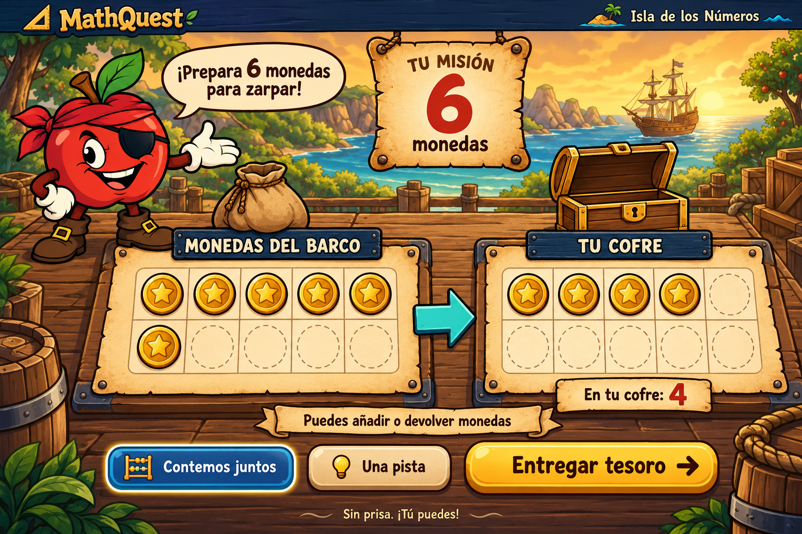

# Kalkú — Prepara el tesoro

Paquete de diseño para entregar al desarrollador: nueve assets PNG, mockup de referencia, referencias de dibujo, manifiesto técnico y prompts efectivos. Generado con la herramienta integrada `image_gen`.

El juego se llama ahora **Kalkú**. El manifiesto, los prompts efectivos, el ZIP y las imágenes de referencia conservan el nombre original MathQuest como registro de procedencia; no definen la marca vigente de la interfaz.

El juego y `mockup-tesoro-monedas.html` permanecen sin cambios. Esta entrega contiene arte y especificaciones de montaje; no implementa la actividad.

## Archivos de producción

Objetos con transparencia alfa real; escenario opaco. Se conservan las resoluciones originales de generación sin reescalado. Son imágenes rasterizadas, no archivos vectoriales ni documentos con capas.

| Archivo | Resolución original | Uso |
| --- | --- | --- |
| `apple-guide.png` | 1254 × 1254 | Manzana Pirata que presenta la misión, mano abierta y sin espada. |
| `coin-gold.png` | 1254 × 1254 | Única moneda repetible; cada instancia representa una unidad. |
| `reserve-pouch.png` | 1254 × 1254 | Bolsa vacía de la reserva, decorativa. |
| `chest-open.png` | 1536 × 1024 | Cofre abierto y vacío durante la preparación. |
| `chest-closed.png` | 1536 × 1024 | Cofre cerrado tras entregar la cantidad correcta. |
| `bay-background.png` | 1536 × 1024 | Bahía y cubierta de madera, sin personaje ni interfaz. |
| `counting-tray.png` | 1536 × 1024 | Panel vacío de pergamino y madera, reutilizable en ambas zonas. |
| `mission-scroll.png` | 1254 × 1254 | Pergamino vacío para el encargo y su cantidad. |
| `label-navy.png` | 2172 × 724 | Letrero vacío reutilizable para los títulos de las zonas. |

`manifest.json` registra dimensiones, alfa, huellas SHA-256, límites visibles y anclajes. `prompts.json` conserva los textos exactos y las referencias de generación. Las imágenes de `references/` son documentación y no deben cargarse como parte de la actividad.

## Composición y montaje

El mockup orienta jerarquía y ambiente. Los assets son recreaciones independientes para montar esa composición; no son capas extraídas ni garantizan coincidencia píxel a píxel.

Orden de capas:

1. Bahía y cubierta como fondo.
2. Personaje a la izquierda; bolsa sobre la reserva y cofre sobre el destino.
3. Pergamino de misión en el tercio superior central.
4. Dos paneles de conteo alineados, con letreros por encima.
5. Cuadrículas, monedas, textos y cantidades como elementos independientes.
6. Ayudas y botón de entrega en la franja inferior.

En móvil, apilar las zonas manteniendo el encargo visible y las áreas interactivas de al menos 44 × 44 px. El personaje puede reducirse o pasar a un retrato sin tapar las monedas.

Las áreas siguientes son porcentajes del lienzo completo de cada PNG, incluidos sus márgenes transparentes. Son zonas recomendadas de superposición, no recortes.

| Pieza | Área segura aproximada | Contenido |
| --- | --- | --- |
| Panel de conteo | x: 12–88 %, y: 28–70 % | Cuadrícula de dos filas por cinco columnas. |
| Pergamino de misión | x: 22–78 %, y: 29–78 % | «TU MISIÓN», cantidad grande y «moneda/monedas». |
| Letrero azul | x: 15–85 %, y: 32–62 % | Título breve en crema y negrita. |

Conservar las proporciones. El letrero y el panel tienen margen transparente vertical: alinear el contenido con la superficie pintada, no con el borde del archivo.

Los cofres comparten tamaño de lienzo, con pequeñas diferencias de posición y anchura. Son estados para intercambio estático, no fotogramas de animación. Alinear por la base y el ancho visible usando los límites y anclajes del manifiesto; no asumir siluetas idénticas al usar el mismo tamaño de elemento.

Tamaños visibles orientativos en escritorio: moneda de 52–68 px, personaje de 280–360 px de alto y cofre de 220–290 px de ancho. Mantener la prioridad del encargo y las monedas. El desarrollador puede crear copias optimizadas para web conservando estos originales como maestros.

## Elementos que se construyen en código

- Todos los textos, números, contadores y mensajes. El mockup completo no se utiliza como fondo de la actividad.
- Diez posiciones por zona, dos filas de cinco; huecos con borde discontinuo e instancias independientes de `coin-gold.png`.
- Globo de diálogo crema con borde oscuro y cola hacia el personaje; texto independiente con espacio para crecer.
- Flecha de transferencia turquesa, barra superior azul marino y marca con los recursos del proyecto.
- Botón principal dorado, ayuda azul y pista crema: esquinas redondeadas, borde oscuro, relieve corto, foco y estados de interacción visibles.
- Franja de apoyo crema bajo las zonas, con texto editable.

No se incluyen imágenes de botones, iconos sencillos de ayuda ni logotipo redibujado. Estas piezas deben mantener texto adaptable, accesibilidad y estados en código, repitiendo el contorno oscuro y el relieve discreto del conjunto.

## Color y tipografía

| Función | Color orientativo |
| --- | --- |
| Marco / barra superior | Azul marino `#0f172a` |
| Letreros y ayuda | Azul `#194c75` |
| Pergamino | Crema `#fff0c5` |
| Acción principal | Dorado `#facc15` |
| Transferencia | Turquesa `#26c6cf` |
| Texto sobre pergamino | Marrón oscuro `#35200f` |
| Confirmación | Verde `#10b981` |

Colores orientativos de interfaz, no mediciones exactas de todos los tonos pintados. Títulos gruesos y redondeados; instrucciones en sans serif clara. Comprobar acentos, signos de apertura y cifras al cargar la fuente definitiva. No se incluyen archivos tipográficos.

## Estados y criterios didácticos

- Preparación: cofre abierto; añadir, devolver y vaciar. Bolsa y cofre no contienen monedas dibujadas.
- Conteo asistido: numeración junto a las monedas del cofre y total, sin taparlas. El total no necesita mostrarse al iniciar.
- Entrega incorrecta: conservar las monedas y dar una pista amable, sin enfadar al personaje ni penalizar visualmente al niño.
- Entrega correcta: cofre cerrado y confirmación. Una breve animación del conjunto puede componerse en código; el personaje tiene una sola pose estática.
- Nuevo encargo: cofre abierto y destino vacío según las reglas del prototipo.

Conservar diez monedas totales y objetivos de 1 a 10. El mockup muestra seis en reserva y cuatro en el cofre para un encargo de seis: es un estado intermedio. No añadir monedas decorativas o montones de oro que se confundan con las unidades que se cuentan.

Textos de referencia: «¡Prepara {cantidad} monedas para zarpar!» (adaptar «1 moneda»), «MONEDAS DEL BARCO», «TU COFRE», «Puedes añadir o devolver monedas», «Contemos juntos», «Una pista», «Entregar tesoro» y «Sin prisa. ¡Tú puedes!».

## Revisión al integrar

Revisar sobre fondos claro y oscuro, mantener contornos completos, contar diez monedas entre ambas zonas y comprobar que los textos sean editables. Verificar teclado, tacto, móvil y reducción de movimiento.

No se incluyen audio, expresiones adicionales, animaciones por fotogramas ni implementación del ejercicio. La entrega mantiene la dirección de arte de Kalkú para desarrollar esta pantalla.
