# Guía Pedagógica y de Gamificación: Matemática 1.º a 8.º Básico (Currículum Chileno)

Documento de referencia para el diseño pedagógico, progresión de contenidos, mecánicas de gamificación y redacción de problemas para **Kalkú**, alineado con las Bases Curriculares del Ministerio de Educación de Chile (MINEDUC) — Decretos N° 439/2012 (1.º a 6.º básico) y N° 614/2013 (7.º básico a 2.º medio).

---

## 1. Fundamentos y Enfoque Didáctico Oficial

### 1.1. Las 4 Habilidades Transversales
Todo ejercicio y mecánica debe estimular al menos una de las cuatro habilidades curriculares:
1. **Resolver problemas**: Enfrentar situaciones sin algoritmo evidente, ensayar caminos y verificar congruencia.
2. **Representar**: Transitar fluidamente entre lo concreto, pictórico, gráfico, verbal y simbólico.
3. **Modelar**: Traducir fenómenos cotidianos a relaciones y expresiones matemáticas.
4. **Argumentar y comunicar**: Explicar por qué un camino es válido y detectar razonamientos erróneos.

### 1.2. El Principio Didáctico Central: Enfoque COPISI
* **Concreto**: Manipulación virtual interactiva (arrastrar piezas, agrupar objetos, mover pesas en balanzas).
* **Pictórico**: Esquemas visuales (modelos de barras tipo Singapur, cuadrículas cuadriculadas, diagramas de puntos, rectas numéricas).
* **Simbólico**: Cifras, signos operacionales y expresiones algebraicas formales.

---

## 2. Matriz Curricular por Niveles (1.º a 8.º Básico)

### 1.º Básico: Construcción de Cantidad y Sentido Numérico
* **Números y Operaciones**:
  * Conteo de 1 en 1, 2 en 2, 5 en 5 y 10 en 10 hasta 100 (ascendente y descendente).
  * Lectura, escritura, representación y orden hasta 20.
  * Concepto de decena (grupo de 10) y unidades. Composición y descomposición aditiva.
  * Suma y resta hasta 20 (agregar, quitar, avanzar, retroceder; dobles y complementos a 10).
* **Patrones y Álgebra**: Patrones de 2 o 3 elementos; noción de igualdad y equilibrio (balanza).
* **Geometría y Medición**:
  * Figuras 2D (círculo, triángulo, cuadrado, rectángulo) y cuerpos 3D (cubo, esfera, cono, cilindro).
  * Posición relativa (arriba/abajo, delante/detrás, izquierda/derecha).
  * Comparación directa de longitud (más largo/corto que) y tiempo (días de la semana).
* **Datos y Probabilidades**: Recolección de información; lectura de tablas y pictogramas (escala 1 a 1).

### 2.º Básico: Valor Posicional, Agrupación y Medida
* **Números y Operaciones**:
  * Ámbito hasta 100 (valor posicional, orden y comparación); conteo por saltos hasta 1.000.
  * Sumas y restas hasta 100 sin canje complejo; cálculo mental.
  * Introducción a la multiplicación como suma reiterada y grupos iguales; tablas del 2, 5 y 10.
* **Patrones y Álgebra**: Patrones numéricos; signos $=$, $>$, $<$.
* **Geometría y Medición**:
  * Caras y aristas de cuerpos 3D; líneas rectas y curvas.
  * Longitud estandarizada en centímetros ($\text{cm}$) y metros ($\text{m}$).
  * Calendario (meses) y reloj digital (horas y medias horas).
* **Datos y Probabilidades**: Pictogramas con escala (cada símbolo vale 2 o 5); gráficos de barras simples; registro de azar simple (moneda, dado).

### 3.º Básico: Tablas Completas, Reparto y Primeras Fracciones
* **Números y Operaciones**:
  * Ámbito hasta 1.000; algoritmos de adición y sustracción con reserva y canje.
  * Tablas de multiplicar hasta $10 \times 10$; matrices y modelos de área.
  * División exacta como reparto equitativo y agrupamiento; relación inversa con la multiplicación.
  * Fracciones de uso común: $\frac{1}{2}, \frac{1}{3}, \frac{1}{4}, \frac{2}{3}, \frac{3}{4}$ (modelos continuos y discretos).
* **Patrones y Álgebra**: Ecuaciones de un paso con balanza e incógnita fija ($\square + a = b$).
* **Geometría y Medición**:
  * Redes planas de cuerpos geométricos 3D simples.
  * Ángulos rectos y no rectos (comparación visual con escuadra).
  * Perímetro de polígonos regulares e irregulares.
  * Tiempo en horas y minutos (análogo y digital); masa en gramos ($\text{g}$) y kilogramos ($\text{kg}$).
* **Datos y Probabilidades**: Diagramas de puntos, gráficos de barras con escala y experimentos aleatorios básicos.

### 4.º Básico: Ampliación Numérica, Decimales y Áreas
* **Números y Operaciones**:
  * Ámbito hasta 10.000 (redondeo y valor posicional).
  * Multiplicación de 3 cifras por 1 cifra; división de 2 cifras por 1 cifra con residuo interpretado.
  * Fracciones equivalentes y sumas/restas de igual denominador.
  * Números decimales: décimos y centésimos; suma y resta de decimales en contextos monetarios y de medida.
* **Patrones y Álgebra**: Ecuaciones e inecuaciones aditivas de un paso; tablas de entrada/salida.
* **Geometría y Medición**:
  * Vistas de cuerpos geométricos (planta, elevación, perfil).
  * Transformaciones isométricas (traslación, rotación, reflexión).
  * Concepto y cálculo de Área en cuadrículas y fórmula para rectángulos/cuadrados ($l \times a$).
  * Volumen intuitivo mediante cubos unitarios.
* **Datos y Probabilidades**: Gráficos de barras dobles; probabilidad cualitativa (seguro, posible, imposible).

### 5.º Básico: Grandes Números, Fracciones Mixtas y Geometría Cartesiana
* **Números y Operaciones**:
  * Naturales hasta $10^9$; multiplicación $2\times 2$ dígitos; división $3\times 1$ dígitos.
  * Operaciones combinadas y jerarquía (paréntesis, multiplicación/división, suma/resta).
  * Fracciones impropias y números mixtos; sumas y restas con distinto denominador mediante fracciones equivalentes.
  * Decimales hasta las milésimas; suma y resta.
* **Patrones y Álgebra**: Generalización de secuencias; ecuaciones de 1.º grado resueltas por operaciones inversas.
* **Geometría y Medición**:
  * Plano cartesiano (coordenadas en el primer cuadrante).
  * Rectas paralelas, perpendiculares e intersecantes.
  * Cálculo de áreas de triángulos y paralelogramos. Conversiones métricas ($\text{mm}, \text{cm}, \text{m}, \text{km}$).
* **Datos y Probabilidades**: Promedio (media aritmética); diagramas de tallo y hojas; probabilidad simple cualitativa.

### 6.º Básico: Razones, Porcentajes y Modelamiento
* **Números y Operaciones**:
  * Múltiplos, factores, números primos y compuestos, mínimo común múltiplo (MCM).
  * Multiplicación y división de números decimales.
  * Razones ($a:b$) y Porcentajes ($10\%, 25\%, 50\%$) representados visual y fraccionalmente.
* **Patrones y Álgebra**: Expresiones con lenguaje algebraico; ecuaciones del tipo $ax + b = c$.
* **Geometría y Medición**:
  * Ángulos opuestos por el vértice, complementarios y suplementarios; suma interior de triángulos y cuadriláteros.
  * Superficie y volumen de cubos y paralelepípedos rectangulares.
  * Teselaciones regulares y semirregulares.
* **Datos y Probabilidades**: Gráficos circulares; comparación de distribuciones; probabilidad experimental vs. teórica.

### 7.º Básico: Enteros, Proporcionalidad y Geometría del Círculo
* **Números**:
  * Números Enteros ($\mathbb{Z}$): recta numérica, valor absoluto, suma y resta en contextos (temperaturas, deudas).
  * Multiplicación y división de fracciones y decimales positivos.
  * Potencias de base 10 y notación científica introductoria. Variaciones porcentuales (descuentos, IVA 19%).
* **Álgebra y Funciones**:
  * Reducción de términos semejantes.
  * Proporcionalidad directa e inversa (constante de proporcionalidad, tablas y gráficos).
* **Geometría**:
  * El círculo: radio, diámetro, número $\pi$, perímetro y área del círculo.
  * Ángulos entre paralelas cortadas por una transversal; construcciones con regla y compás.
* **Probabilidad y Estadística**:
  * Medidas de tendencia central (media, mediana, moda) y rango.
  * Regla de Laplace para eventos equiprobables y diagramas de árbol.

### 8.º Básico: Racionales, Potencias, Raíces y Función Afín
* **Números**:
  * Multiplicación y división en $\mathbb{Z}$ y en $\mathbb{Q}$ (regla de los signos).
  * Propiedades de potencias de base racional y exponente entero; raíces cuadradas y estimación.
* **Álgebra y Funciones**:
  * Expresiones algebraicas y productos notables básicos.
  * Función lineal ($f(x) = mx$) y función afín ($f(x) = mx + n$): pendiente, coeficiente de posición y gráficos.
  * Ecuaciones e inecuaciones lineales con coeficientes racionales.
* **Geometría**:
  * Teorema de Pitágoras y sus aplicaciones.
  * Área y volumen de cilindros y prismas rectos.
  * Composición de transformaciones isométricas mediante vectores.
* **Probabilidad y Estadística**:
  * Medidas de posición: cuartiles, percentiles y diagramas de cajón.
  * Principio combinatorio multiplicativo para sucesos compuestos.

---

## 3. Línea de Progresión Vertical (Autopistas Conceptuales)

```mermaid
flowchart TD
    subgraph AritmeticaAlgebra ["Autopista 1: De la Aritmética al Álgebra"]
        AA1["1.º-2.º: Conteo y equilibrio con balanzas"]
        AA2["3.º-4.º: Casillas incógnitas y tablas de valores"]
        AA3["5.º-6.º: Jerarquía operativa y ecuaciones formales"]
        AA4["7.º-8.º: Términos semejantes, regla de signos y Funciones Afines"]
        AA1 --> AA2 --> AA3 --> AA4
    end

    subgraph FraccionesProporciones ["Autopista 2: Del Reparto a la Proporcionalidad"]
        FP1["2.º-3.º: Reparto equitativo y fracciones de uso común"]
        FP2["4.º-5.º: Equivalencias, números mixtos y decimales"]
        FP3["6.º: Razones y Porcentajes"]
        FP4["7.º-8.º: Proporcionalidad Directa/Inversa y Racionales"]
        FP1 --> FP2 --> FP3 --> FP4
    end

    subgraph GeometriaMedida ["Autopista 3: Del Espacio a la Medida Formal"]
        GM1["1.º-2.º: Formas 2D/3D y longitud en cm/m"]
        GM2["3.º-4.º: Perímetro de bordes y Área por cuadrícula"]
        GM3["5.º-6.º: Plano cartesiano, ángulos y volumen de prismas"]
        GM4["7.º-8.º: Perímetro/Área del Círculo (π) y Teorema de Pitágoras"]
        GM1 --> GM2 --> GM3 --> GM4
    end

    subgraph DatosProbabilidad ["Autopista 4: De la Información a la Incertidumbre"]
        DP1["1.º-2.º: Pictogramas y registros de conteo"]
        DP2["3.º-4.º: Barras con escala y eventos seguros/imposibles"]
        DP3["5.º-6.º: Promedio, gráficos circulares y frecuencia experimental"]
        DP4["7.º-8.º: Mediana, Moda, Cuartiles, Laplace y Combinatoria"]
        DP1 --> DP2 --> DP3 --> DP4
    end
```

---

## 4. Marco de Gamificación Educativa

### 4.1. Bucle Central de Aprendizaje (Core Learning Loop)
1. **Desafío Didáctico**: Situación contextualizada con apoyo interactivo o visual.
2. **Acción Interactiva COPISI**: El jugador manipula, agrupa o calcula.
3. **Feedback Inmediato**:
   * *Acierto*: Animación de recompensa, aumento de racha de combo sonora y explicación de por qué fue correcto.
   * *Error*: No castigar pasivamente; desplegar pista interactiva con descomposición del problema.
4. **Jefe de Nivel (Evaluación Auténtica Integrada)**: Reto que sintetiza los conceptos del mundo sin recurrir a pruebas de reflejos ajenos a las matemáticas.

### 4.2. Mecánicas de Juego No Punitivas
* **Vidas Recargables**: La pérdida de vidas no bloquea al estudiante; se recuperan mediante retos breves de repaso o exploración libre.
* **Pistas Escalonadas**:
  1. *Nivel 1*: Pista visual (resaltar datos o mostrar diagrama).
  2. *Nivel 2*: Pista procedimental (descomponer en pasos más simples).
  3. *Nivel 3*: Explicación modelada (resolver un caso análogo).

---

## 5. Criterios para Textos, Narrativa y Preguntas

1. **Carga Cognitiva Reducida**: Enunciados breves (máximo 2 a 3 líneas), datos numéricos destacados en negrita y apoyo visual directo.
2. **Contexto Local Chileno**:
   * Precios y transacciones en pesos chilenos ($\$$), usando valores enteros realistas.
   * Decimales aplicados a magnitudes físicas: litros ($\text{L}$), metros ($\text{m}$), kilogramos ($\text{kg}$).
   * Uso de la **coma decimal** ($2,5\text{ kg}$) según la norma nacional.
3. **Distractores Diagnósticos**: Cada opción incorrecta debe responder a un obstáculo cognitivo previsible (ej. confundir perímetro con área, invertir decenas con unidades, sumar denominadores en fracciones).
4. **Explicaciones Claras**: La retroalimentación debe enseñar la estrategia conceptual y no limitarse a "Respuesta correcta: A".
